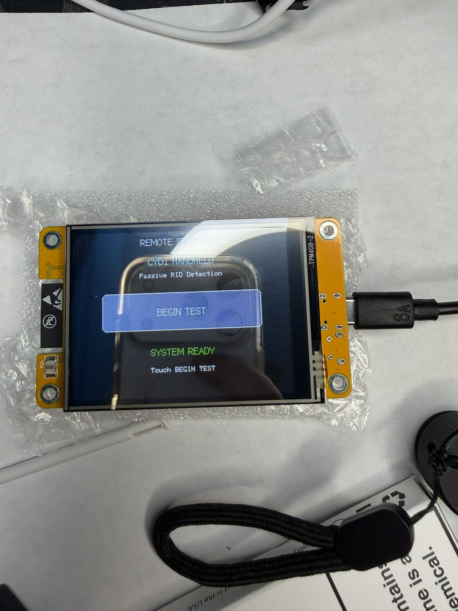

# RID-01 — Passive Remote ID Handheld

**CyberSecurit Hub | Embedded systems · wireless protocols · UAS situational information**

An independently tested touchscreen **passive cooperative Remote ID receiver** built on a Waveshare ESP32-S3-Touch-LCD-3.5 Rev2.0. The existing firmware processes **Bluetooth Low Energy (BLE) Remote ID** data, manages multiple targets and lifecycle states, and displays coordinate-derived geographic context. **2.4 GHz Wi-Fi Beacon Remote ID and onboard GNSS are V1 requirements still under development.**

> **Engineering status (2026-11-04):** Newest *provisionally accepted, physically installed and source-frozen* local candidate: **BAT-D4E-3B low-voltage operator warning**, SHA-256 `2704617b96b24bc394ce4a9b1b7dbfa8b367c0e31776923e0ffd1ef026528670`. It passed USB-only controls, 15-minute LiPo-only healthy-voltage operation, simulated voltage warning state/display, and two real R111S BLE capture regressions. The low-voltage trigger thresholds and charger termination have **not** been physically qualified. Previous accepted BAT-D4D-R2 (`a485eadad7af3ac706db9e10e053e492bd48b7eb61460f17374c989bf00d2d0e`) remains frozen rollback; older working master `.ino` still reflects historical D4H. The **historical CYD1 firmware and sanitized selected photographs are now imported**. The current Waveshare firmware remains archived **on Kali only**, not yet imported or cleared for public release.

## From CYD1 to Waveshare — historical origin (2026)

RID-01 began on the **ESP32-2432S028R (CYD1)**, where the BLE Remote ID decoder, four-slot lifecycle engine, touch UI, PRIVATE/OPEN controls and continuous scanning were validated **October 12, 2026**. The accepted CYD1 source and curated historical photographic evidence have now been reconstructed for this private repository. The Waveshare RADAR, GNSS and battery stages came afterward.

Read the [CYD1 history](docs/history/CYD1.md), [acceptance evidence](docs/validation/CYD1.md), [integration compile-fix case study](docs/history/CYD1-B2A-compile-fix.md), and [firmware directory](firmware/cyd1/README.md). Historical test dates are **not** represented as original Git commit dates.

## Current validated behavior

- Passive BLE Remote ID parsing and up to **four tracked target slots** (T01–T04).
- ACTIVE/STALE/LOST lifecycle, target reacquisition, continuous scan windows, operator-owned START/STOP/RESCAN.
- TARGETS and a **north-up, coordinate-derived RADAR-style display**. **Not** an RF radar and **not** RSSI-based ranging.
- Geographic plotting requires a valid receiver reference **and fresh target coordinates**. Stale coordinates are not plotted; LOST targets are hidden.
- PRIVATE (default) / OPEN output modes and frozen SNAPSHOT handling.
- Physically tested cold-power-on acknowledgment and D4G STOP/HOME. Historical D4H report recorded 5/5 pass; a later instrumented physical RESET check showed the board may re-require acknowledgment after RESET. See [validation](docs/VALIDATION.md) for the dated correction.

## V1 target (not yet delivered)

| Capability | Current state |
| --- | --- |
| BLE Remote ID | Implemented and previously validated |
| 2.4 GHz Wi-Fi Beacon Remote ID | Required for V1; proof-of-concept and real-DJI testing pending |
| GNSS receiver position | LC76G ordered; integration pending |
| BLE + Wi-Fi combined operation | Required target; ESP32-S3 coexistence/channel performance unproven |
| Battery operation/charging | Polarity, 45-min R2 mixed-use endurance, 15-min 3B LiPo regression, and USB-only PMIC register audit PASS; low-voltage operator warning provisionally source-frozen, physical activation threshold, SOC accuracy and charge termination OPEN |
| 5 GHz / non-cooperative RF | **Not part of V1**; future hardware research |

## New accepted work: battery engineering (October 30–November 4, 2026)

- **BAT-D4B** (2026-10-30): Power/voltage header across supported screens; accepted source SHA-256 `f26d860255f933de068c71b4ce8960187cbcad6ffa634ed051c8fd0277eba3ea`.
- **BAT-D4C** (2026-10-30): Cell-temperature-sensing limitation and operator charging-safety notice; SHA-256 `5a55a5d9fe0b95ecf4943199793fbdba87016ca10d1fa5bf12ea138dfb8e314e`.
- **BAT-D4D-R2** (2026-10-31): Provisional `EST:%` and voltage/power state displayed on HOME, SELECT OUTPUT MODE, TARGETS and RADAR; ACK/SNAPSHOT excluded. Live power-source tests PASS; accepted/frozen hash `a485eadad7af3ac706db9e10e053e492bd48b7eb61460f17374c989bf00d2d0e`.
- **BAT-D4E-1** (2026-11-03): 45-minute supervised LiPo-only mixed-use HOME/TARGETS/RADAR/STOP, real Ruko R111S reception and navigation; observed 3.88V / EST82% at start and 3.80V / EST64% at end, ~9,000 approximate on-device counter units (not independently validated loss statistic). **PASS limited 45-min mixed-use test**, not maximum endurance.
- **BAT-D4E-2B** (2026-11-04): 120-sec USB-only read-only AXP2101 register audit, stable charger parameters (programmed 200mA CC, 4.20V CV), no LiPo attached; test firmware subsequently removed and R2 flashed and hash-verified. Sudden earlier SOC transition of about 75% to 30% on USB connection remains unexplained and the gauge **is not calibrated**.
- Direct LiPo temperature monitoring is absent; supervised charging only. See [baselines](docs/BASELINES.md), [validation](docs/VALIDATION.md) and [Issue #7](https://github.com/Forgedin3D/cybersecurit-hub-rid01/issues/7).

**Agreed sequence:** finish pre-GNSS battery closeout → audit/import code and consolidate repository → integrate LC76G → **freeze a fully tested BLE + battery + GNSS rollback** → only then attempt Wi-Fi Beacon on the shared ESP32-S3 radio. See the [updated roadmap](docs/ROADMAP.md).

## BAT-D4E-3B provisional warning acceptance — November 4, 2026

The operator froze an accepted local archive with hash `2704617b96b24bc394ce4a9b1b7dbfa8b367c0e31776923e0ffd1ef026528670` after clean compile and controlled tests. Battery-only LOW BATTERY warning is based on valid measured pack voltage, not uncalibrated EST:%. Candidate: **≤3.70V held 15s** activates; **≥3.80V held 30s** clears. This is an operator alert, **not** an automatic low-voltage cutoff.

Test evidence: synthetic state-machine 12/12 PASS; visual simulation and clearing on HOME/OUTPUT MODE/TARGETS PASS; normal USB-only 3B controls/ACK/SNAPSHOT/RESCAN/STOP PASS; 15-minute LiPo-only mixed UI/scan test (3.83V→3.78V, no false alert or unusual heat) PASS. Two separate Ruko R111S captures decoded **1,012 and 961 validated RID packets**, with T01 ACTIVE/VALID and continuous BLE scan windows. Manually supplied receiver reference produced RADAR READY; a READY→ACQUIRING→READY transient was recorded, exact prerequisite pending investigation. Operator saw **no STALE or LOST** while aircraft remained powered; forced transmitter-off lifecycle was not tested in this stage. Actual low-cell alert threshold, calibrated battery capacity, direct cell temperature, end-of-charge termination, GNSS and Wi-Fi remain open.

Source is still stored locally on the operator's Kali VM, not on GitHub. See [baseline freeze](docs/BASELINES.md), [test evidence](docs/VALIDATION.md), and [Issue #7](https://github.com/Forgedin3D/cybersecurit-hub-rid01/issues/7).

## Hardware and tools

Waveshare ESP32-S3-Touch-LCD-3.5 Rev2.0 (480 × 320), Kali Linux VM, Arduino CLI, Espressif Arduino core 3.3.11; Ruko R111S and low-power synthetic bench beacon for validation. DJI Mini 5 Pro is planned for Wi-Fi Remote ID demonstrations **only after reception is implemented and verified**.

## Engineering records

- **[Full project handoff — October 29, 2026](docs/HANDOFF_2026-10-29.md)** (next-thread recovery, firmware hashes, test evidence and remaining gates)
- [Architecture and technical constraints](docs/ARCHITECTURE.md)
- [Firmware acceptance baselines and hashes](docs/BASELINES.md)
- [Validation evidence and open QA](docs/VALIDATION.md)
- [V1 roadmap and scope boundaries](docs/ROADMAP.md)
- [Local development, source import and release process](docs/DEVELOPMENT.md)
- [Data protection and responsible test practices](docs/SECURITY.md)
- [Project provenance and AI/third-party attribution](docs/PROVENANCE.md)

## Scope and safety

This is an **informational receiver of cooperative broadcasts**, not a certified collision-avoidance instrument or a guarantee of aircraft detection. Broadcast content may be incomplete, delayed, wrong, or spoofed. Flight operations remain subject to applicable rules; this device alone must not be used to make flight-safety decisions.

**Repository visibility:** Private. No code license granted at this stage; third-party source/license obligations will be reviewed before publication. Development and documentation are human-directed with assistant support; see [provenance](docs/PROVENANCE.md).
