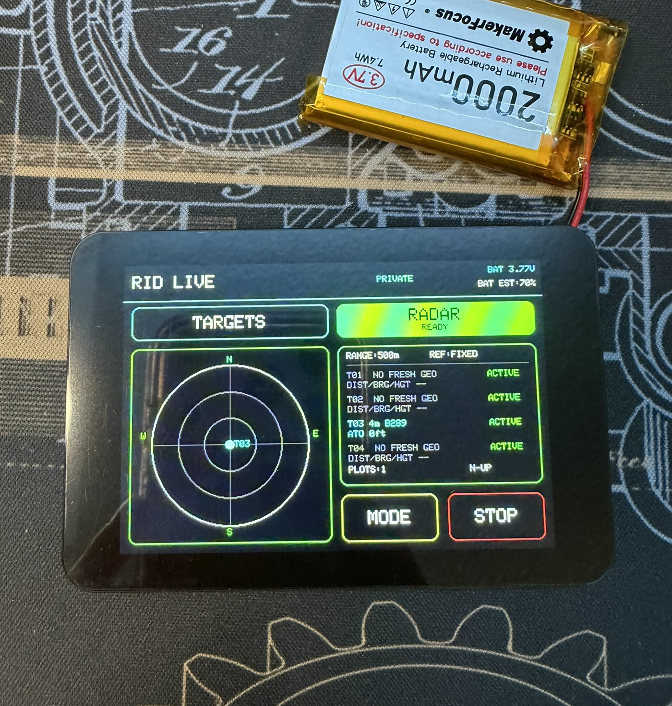

# RID-01 — Passive Remote ID Handheld

**CyberSecurit Hub | Embedded systems · wireless protocols · test engineering**

A touchscreen receiver for cooperative **Bluetooth Low Energy Remote ID** broadcasts, developed first on CYD1 and migrated to a Waveshare ESP32-S3-Touch-LCD-3.5 Rev2.0. It tracks up to four source slots and plots eligible aircraft positions relative to an explicitly supplied receiver reference.

**Pre-GNSS snapshot: November 6, 2026.** Current locally frozen reference: **BAT-D4E-3B, provisionally accepted November 4**. Receiver GNSS and Wi-Fi Beacon reception are **not implemented/validated in this snapshot**. The documentation/source import is retrospective; it does not backdate Git history or imply a new hardware acceptance.

> **Review status:** This is the proposed pre-GNSS repository update. Source/media checks are staged, and the November 6 isolated Kali compile passed with returned evidence reconciled. Final owner media/package review and explicit push approval remain pending. See the [build evidence review](docs/waveshare/records/CLEAN-COMPILE-REVIEW-2026-11-06.md). Repository visibility and license policy must not change as part of this import.



*November 6 bench demonstration: operator-reported R111S plus three SYSTEM-only ESP32 beacons. Four ACTIVE rows, but only the R111S provides usable aircraft Location/Vector data, so PLOTS:1 is correct. REF:FIXED is manually entered—not onboard receiver GNSS. T01–T04 are session slots, not fixed device identities.*

## What works—and what the evidence means

| Capability | Evidence-bounded status |
|---|---|
| Passive BLE Remote ID | Implemented; real R111S and controlled SYSTEM-beacon tests recorded |
| Four target slots | Independent ACTIVE/STALE/LOST presentation and selected-target views |
| Geographic RADAR-style view | Coordinate-derived horizontal separation and true bearing; north-up; stale geography not plotted |
| Operator workflow | HOME → output mode → START; TARGETS/RADAR; frozen SNAPSHOT; RESCAN; STOP/HOME |
| Privacy | PRIVATE defaults and UI/serial redaction; not encryption or transmitter authentication |
| Battery UI | Voltage, BAT/USB/CHG state and provisional EST percentage; absent on ACK/SNAPSHOT |
| Low-voltage alert | Provisional voltage-based warning, not automatic cutoff; simulation tested, real low-cell activation still unqualified |
| GNSS / Wi-Fi | Next phases, not capabilities of this baseline |

**Not an RF radar.** The display does not estimate distance from RSSI or measure time of flight. Its 500 m display scale is not a measured detection range. Earlier four-plot photos used explicitly synthetic coordinate fixtures; they are not four-aircraft reception tests.

## Read the engineering evidence

[Current state and open gates](docs/waveshare/STATUS.md) · [Migration history](docs/waveshare/HISTORY.md) · [RADAR decisions and debugging](docs/waveshare/RADAR.md) · [Validation matrix](docs/waveshare/VALIDATION.md) · [Battery qualification boundaries](docs/waveshare/BATTERY.md) · [Media and captions](docs/waveshare/MEDIA.md)


*Early on-device visual development. Synthetic fixtures made layout/geometry repeatable; later production checkpoints remove the injected targets.*

## Preserved source identity

[Current reference sketch](firmware/waveshare/reference/RID_UI_Migration/RID_UI_Migration.ino):

```text
2704617b96b24bc394ce4a9b1b7dbfa8b367c0e31776923e0ffd1ef026528670
```

[Source manifest and historical selection](firmware/waveshare/SOURCE_MANIFEST.json) preserve original bytes and archive names. The plain working `.ino` on Kali remains the older D4H source; do not treat that filename as the latest accepted release. [Build instructions](docs/waveshare/BUILD.md) use an isolated copy of the explicitly named newer freeze.

## Original CYD1 chapter

The original CYD1 reference, accepted October 12, remains preserved separately: [history](docs/history/CYD1.md), [integration case study](docs/history/CYD1-B2A-compile-fix.md), [acceptance evidence](docs/validation/CYD1.md), and [firmware](firmware/cyd1/README.md). Its test counts and binary sizes must not be attributed to the Waveshare.

## Next milestones

Complete this pre-GNSS source/build/documentation gate → integrate LC76G receiver reference → regress BLE, power and operator controls together → freeze source/configuration/dependencies/build artifacts → develop Wi-Fi-only reception → evaluate combined BLE/Wi-Fi operation. Separate BLE-only and Wi-Fi-only modes are a proposed fallback, not implemented behavior. See [roadmap](docs/waveshare/ROADMAP.md).

## Provenance and safety

Christopher Estrada directed requirements, operated equipment, reported test observations and controlled acceptance. Assistant support contributed proposals, code, analysis and documentation; third-party dependencies are separately attributed. [Provenance/notices](docs/waveshare/PROVENANCE.md).

This is an informational receiver of cooperative, potentially incomplete or spoofed broadcasts—not a certified collision-avoidance device or detection guarantee. No direct cell-temperature sensor is monitored. Supervised battery use and unresolved battery qualifications remain documented. Original media and unsanitized logs remain private. This private review does not assign a new project-wide license or authorize public release.
