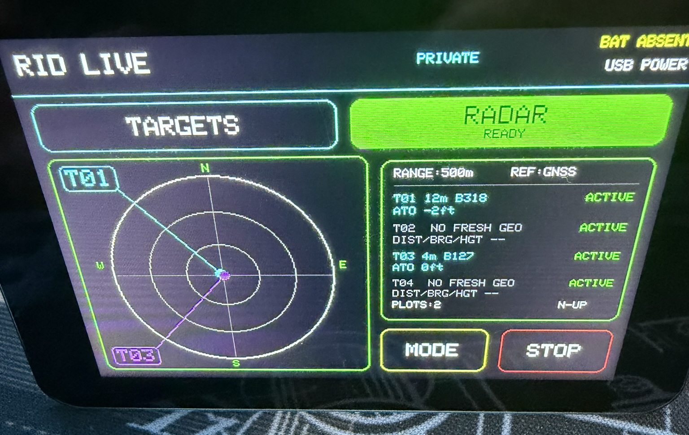

# RID-01 | Passive Remote ID + GNSS Handheld Prototype

**CyberSecurit Hub — embedded systems, wireless protocols and test engineering**\
**Final engineering checkpoint:** R7, November 17, 2026\
**Project status:** **Concluded as a cybersecurity/embedded-systems portfolio prototype.** Not a commercial or field-qualified Remote ID receiver.

*Actual Waveshare ESP32-S3 hardware photograph, R7 bounded test. Colored T01/T03 callouts correspond to real R111S Remote ID transmitters. T02/T04 were SYSTEM-only ESP32 beacons without fresh usable geographic position. `RANGE:500m` is the graphic's scale, **not** a demonstrated receiving range.*

## Project summary

RID-01 is an independently operated, **AI-assisted engineering project** exploring passive Bluetooth Low Energy (BLE) Remote ID reception, source lifecycle tracking, NMEA GNSS parsing, and a geographic visualization on an ESP32-S3 touchscreen. Its journey started on an earlier CYD1 board and migrated to a Waveshare ESP32-S3-Touch-LCD-3.5 Rev2.0 connected to an LC76G GNSS module.

RID-01 does **not** perform active radio-frequency radar, RF direction finding, or range estimation from RSSI. It computes display distance and bearing from cooperative broadcast position data relative to a selected receiver reference. It cannot verify the truth of a broadcast position or guarantee detection of aircraft.

## Implemented and observed

| Area | Evidence-based result |
|---|---|
| BLE Remote ID receiver | Passive parsing and up to four session target slots; mixed test with **two R111S Remote ID transmitters plus two controlled ESP32 SYSTEM beacons** |
| Target lifecycle | ACTIVE / STALE / LOST handling, view switching, snapshot, RESCAN and STOP/HOME |
| GNSS receiver reference | External LC76G integrated over UART; checksum-validated NMEA; GNSS-powered RADAR READY demonstrated |
| Geographic RADAR | North-up plotted positions when fresh usable geography is present; R6 corner labels, R7 slot colors and leader lines |
| Power/UI | Standalone LiPo-powered bounded functional observation, voltage/state header and provisional estimated percentage; **not a qualified fuel gauge or battery safety certification** |
| Diagnostic automation | Python guarded staging, checksum/serial analysis and privacy-conscious guided captures; SHA-256 source and build-artifact evidence |
| R7 acceptance | Bounded 396.652-second guide completed; 169 accepted complete dashboards with four ACTIVE sources; **zero new recorded GNSS/UART errors**; 28 incomplete host dashboard notices retained |

These are bounded test observations, not general field-performance guarantees. Read [R7 validation](docs/waveshare/R7_VALIDATION.md) and [final assessment](docs/waveshare/R7_FINAL_ASSESSMENT.md) for exact scope.

## Why development stopped

Outdoor property trials with two R111S units revealed unreliable real-world tracking: the operator repeatedly observed target disappearance while increasing separation, often around/beyond approximately **35 m** under that setup. No calibrated RF-loss measurement isolated a unique root cause. This **operator-observed field shortfall**, together with the architecture's antenna, GNSS integration, display and power-management compromises, did not satisfy the intended portable field-instrument requirements.

Further development on this board was deliberately stopped. **Wi-Fi Beacon RID reception, microSD storage/logging, a proposed additional RADAR display, and production safety qualification were not implemented**. The earlier engineering living record contains now-superseded future plans; this dated closeout is the controlling project status. The successful BLE/GNSS prototype is retained as a portfolio artifact.

## Code and evidence navigation

- **[Complete, tested R7 C++/Arduino source](firmware/waveshare/final-r7/RID_UI_Migration/RID_UI_Migration.ino)** — source SHA-256: `7874c62c8d94be5684311e2f76dbec70ca205bf4c24a3cea005c1b03f92ddaf2`
- [Firmware provenance and recorded build](firmware/waveshare/final-r7/README.md) · [R7 build/reproducibility detail](docs/waveshare/R7_BUILD.md)
- [System architecture and data boundaries](docs/waveshare/R7_ARCHITECTURE.md)
- [Engineering case study](docs/waveshare/R7_CASE_STUDY.md)
- [R7 validation and measurements](docs/waveshare/R7_VALIDATION.md) · [structured evidence summary](docs/waveshare/records/R7_ACCEPTANCE_SUMMARY.json)
- [Final engineering decision and limitations](docs/waveshare/R7_FINAL_ASSESSMENT.md)
- [Python automation workflow](tools/rid01/README.md)
- [Curated photo gallery](docs/waveshare/R7_MEDIA.md)
- [CYD1 project history](docs/history/CYD1.md) and [earlier Waveshare source](firmware/waveshare/reference/RID_UI_Migration/RID_UI_Migration.ino) are preserved as **historical** evidence; neither is the final R7 firmware.

## Technology and contributions

**Hardware:** ESP32-S3 touchscreen, external LC76G GNSS, R111S Remote ID transmitters, controlled ESP32 beacons, supervised LiPo battery.\
**Software:** Arduino/C++, BLE/OpenDroneID-related parsing, NMEA/UART, Arduino CLI + ESP32 core 3.3.11, Python 3 test and staging tools, SHA-256 validation, GitHub.

**Contribution disclosure:** The owner established requirements, integrated and operated the hardware, executed tests, identified field deficiencies and selected acceptance/closure decisions. AI assistance contributed code proposals, Python scripts, analysis and documentation; vendor examples and external libraries remain separately attributed. The portfolio does **not** claim that the owner independently authored every line or has production software-engineering credentials.

## Security, usage and source licensing

The project is a passive educational prototype, not a certified safety, counter-UAS or law-enforcement instrument. Remote ID data can be missing, delayed, inaccurate or spoofed; PRIVATE is an output-redaction policy, not encryption or authentication. Original field logs, location-bearing images, and identifiable transmitter data remain out of the public evidence gallery.

Third-party dependencies are **not vendored wholesale**. The original project has **no project-wide license grant**; publication does not implicitly authorize reuse. See [provenance](docs/waveshare/PROVENANCE.md) and [security](docs/SECURITY.md) before redistribution.
