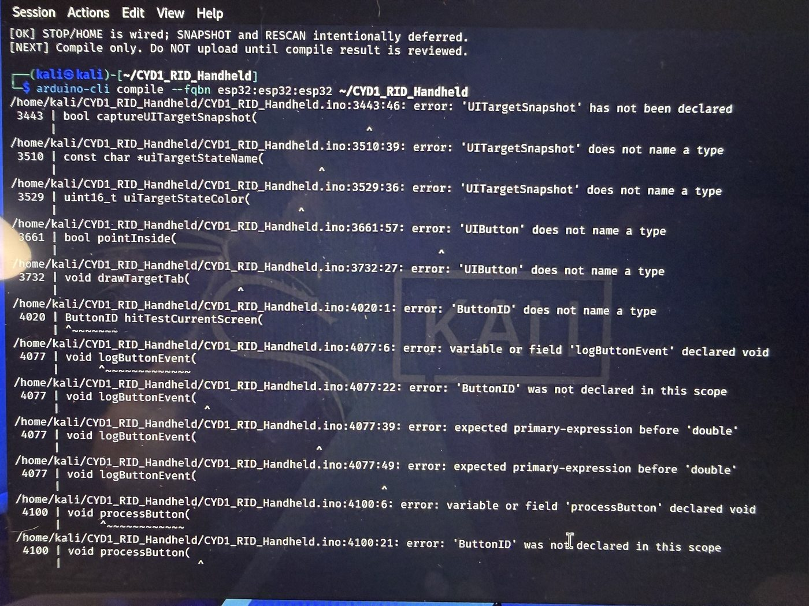
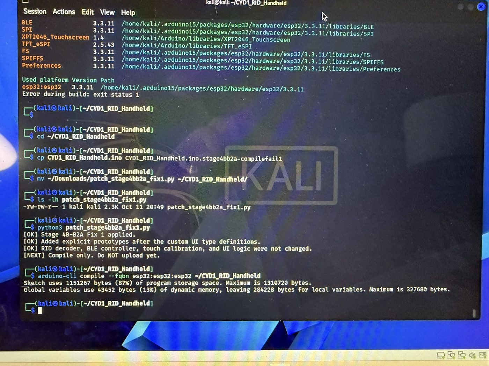

# Case study — fixing the Stage 4B-B2A CYD1 integration build

**Historical event:** October 11, 2026. **Reconstructed/committed:** November 4, 2026.

## Engineering problem

The CYD1 backend had working BLE Remote ID decoding and asynchronous scanning, and the touch UI had been tested separately. Stage **4B-B2A** combined them using shared target data and a FreeRTOS mutex. Its first combined sketch failed compilation because Arduino's `.ino` automatic function-prototype generation referred to custom UI types before those types had been declared.

This is documented in the project acceptance report and preserved by two distinct, hashed source snapshots—not an invented failure for the portfolio.



## Corrective change

`patch_stage4bb2a_fix1.py` added explicit prototypes **after** the definitions of the relevant custom structures/enumerations, including `UITargetSnapshot`, `UIButton`, and `ButtonID`, and **before** the corresponding function implementations. For example:

```cpp
bool captureUITargetSnapshot(uint8_t index, UITargetSnapshot &snapshot);
ButtonID hitTestCurrentScreen(double x, double y);
void processButton(ButtonID button);
```

These declarations are shown for explanation; the actual full diff is preserved by the pre-fix and post-fix source snapshots below. The change is limited to function declarations in the verified source diff; it did not change the BLE decoder or touch geometry.



## Verified source lineage

| Artifact | SHA-256 |
| --- | --- |
| [Before fix](../../firmware/cyd1/history/stage4b-b2a-compilefail.ino) | `8ff4da0d1037153ef255778d19cab427c28069358dc1d653e51914abd0d70e03` |
| [After fix](../../firmware/cyd1/history/stage4b-b2a-compilepass.ino) | `bf157de938adee6f145c8830170c4ba6a38e51a773e0d1d6cdb43243bde872d1` |
| [Historical patch script](../../firmware/cyd1/history/patch_stage4bb2a_fix1.py) | `c04f8098741c210f2d506b8ca79c2e973ebe2d5ba6c4e6d1d55a55870e2a726b` |

A local read-only diff check on November 4 confirmed that the preserved before/after versions differ by the insertion of the explicit prototype block. The October 12 technical record reports that compilation and subsequent physical hardware testing passed. **The archived sources were not rebuilt or reflashed during this reconstruction.**

> **Safety:** This patch script is historical source-modification evidence. Do not execute it against the frozen accepted sketch. Work on copies and verify hashes before using any historical firmware.

## Transferable skills

Root-cause investigation, build-system behavior, dependency ordering, static diffs, concurrency-boundary integration, frozen rollback points and hardware-gated acceptance.
