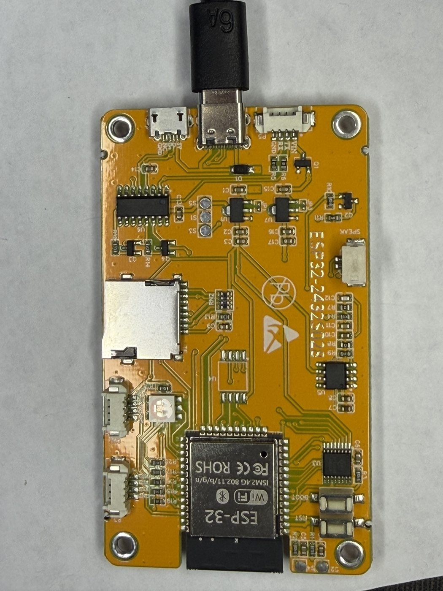
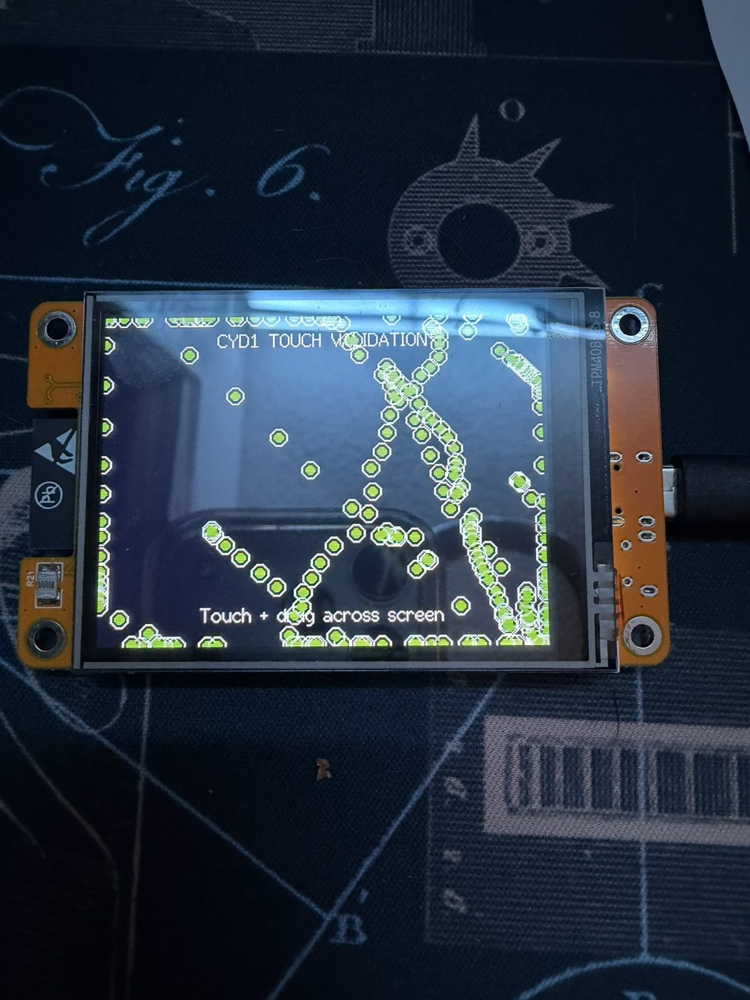
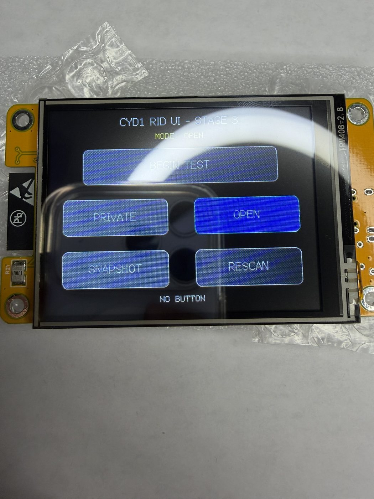
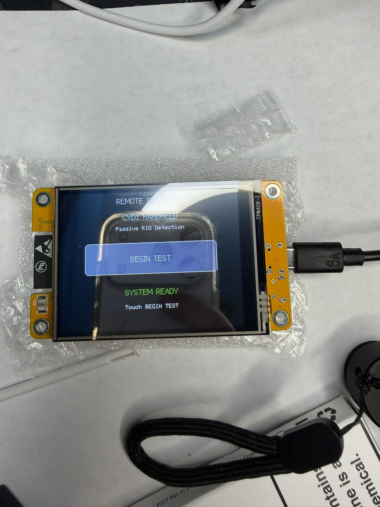
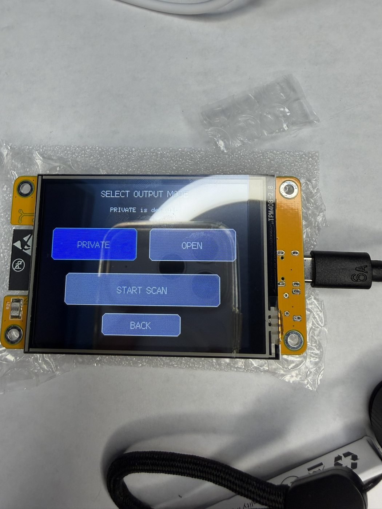

# CYD1 — the original RID-01 receiver (September–October 2026)

> **Historical reconstruction entered November 4, 2026.** The dates below describe original development/test events, not backdated Git commits. This is an engineering prototype for passive reception of cooperative Remote ID broadcasts, **not** a radar, threat detector, certified collision-avoidance device, or complete aircraft-detection system.

## Starting platform and design objective

RID-01 began on an **ESP32-2432S028R (CYD1)** with a 2.8-inch resistive touchscreen, before the later Waveshare ESP32-S3 migration. The CYD1 unit used an ESP32-WROOM, XPT2046 resistive touch, TFT_eSPI graphics and the ESP32 Arduino BLE library. Its objective was to decode applicable BLE Remote ID service data and provide an operator-owned touchscreen workflow that could support multiple independently tracked transmitters.

## Dated engineering progression

| Approximate date (2026) | Milestone | Evidence class |
| --- | --- | --- |
| September 17–22 | Touch-coordinate collection, calibration experiments, screen mapping and touch validation; first radio/BLE bring-up | Local source archives and operator photographs |
| October 9–10 | BLE service-data inspection, Remote ID classification/decoding, four-slot target engine, type counters and target lifecycle | Preserved Stage 7C backend source; prior development records |
| October 11 | Touch UI, HOME → BEGIN TEST → PRIVATE/OPEN → START SCAN, T01–T04 selection | Validated historical UI snapshot and photos |
| October 11 | Async scan backend integrated with UI and mutex-protected target snapshots; compile error repaired with explicit type-aware function prototypes | Preserved B2A fail/pass snapshots and patch script |
| October 11–12 | Frozen SNAPSHOT/RETURN, RESCAN, continuous internal scan-window rollover until operator STOP/HOME | B2B/B2C preserved source and test report |
| **October 12** | **CYD1 Stage 4B-B2C functional acceptance** | Matching accepted source/compile-pass/hardware-pass hashes plus acceptance report and two recovered raw serial logs |

The sources have original date-bearing filenames and local filesystem history; camera timestamps provide additional context but are not an independent time authority.

## Touchscreen and workflow evolution

The prototype's touch controls evolved from calibration and synthetic UI testing into a real BLE-backed display. The final CYD1 workflow was:

`HOME → BEGIN TEST → SELECT OUTPUT MODE (PRIVATE default or OPEN) → START SCAN → LIVE TARGETS`

During scanning an operator could select T01–T04, freeze a selected-target SNAPSHOT, return to live display, RESCAN for a fresh session, change privacy mode and STOP/HOME. The snapshot freezes **presentation**, not BLE collection.

Historical touch and screen photographs

Touch-validation screen:

Early Stage 3 touch interface (the buttons were a UI prototype; not evidence of a live BLE backend):

Later integrated HOME screen:

PRIVATE/OPEN output selection:

## Backend architecture (accepted CYD1)

1. Passive BLE advertisement callback filters and decodes supported OpenDroneID service data, associating observations by advertiser address.
2. A bounded four-entry table tracks target allocation, last-received timestamps, individual Remote ID message types, RSSI and ACTIVE/STALE/LOST lifecycle state.
3. FreeRTOS mutex protects shared targets. The UI copies selected-target fields to a fixed-size snapshot before rendering, rather than drawing directly within BLE callbacks.
4. An asynchronous scanner rolls over internal scan windows (~60 seconds); the **operator-visible** session continues until STOP/HOME or deliberate RESCAN.
5. PRIVATE presentation redacts identifiers and coordinates; OPEN is a deliberate local operator choice. Logs/screenshots must still be independently sanitized.

**Limitations:** Maximum four slots, association by advertiser address (rotation can cause a new allocation), BLE-only receiver, no onboard GNSS/coordinate-derived RADAR on CYD1, no battery system and no persistent logging. RSSI is not calibrated range. The CYD1 final accepted sketch used about 88% of its selected application flash partition in the recorded toolchain. Those limitations were part of the decision to migrate to a more capable ESP32-S3 platform.

## Release evidence and practical lessons

Final accepted source: [`firmware/cyd1/reference/CYD1_RID_Handheld/CYD1_RID_Handheld.ino`](../../firmware/cyd1/reference/CYD1_RID_Handheld/CYD1_RID_Handheld.ino), SHA-256 `a76f5a9cf94899af528b5bcdace01e2bb7207ed3ecf3f4690f8d63ee9516525c`.

- [CYD1 validation matrix and results](../validation/CYD1.md)
- [B2A compile failure → repair case study](CYD1-B2A-compile-fix.md)
- [Source/asset integrity register](CYD1-MANIFEST.md)

The original serial logs, unmodified camera photographs, factory flash images, and full 21-page acceptance report are retained outside GitHub. Public-facing evidence consists only of selected, re-encoded, metadata-cleaned photographs and sanitized summaries. The repo was created on October 29, **after** the CYD1 development. No prior Git history is implied.
