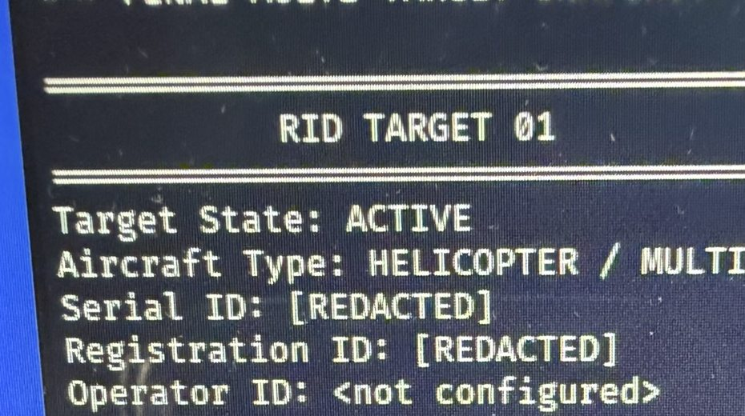
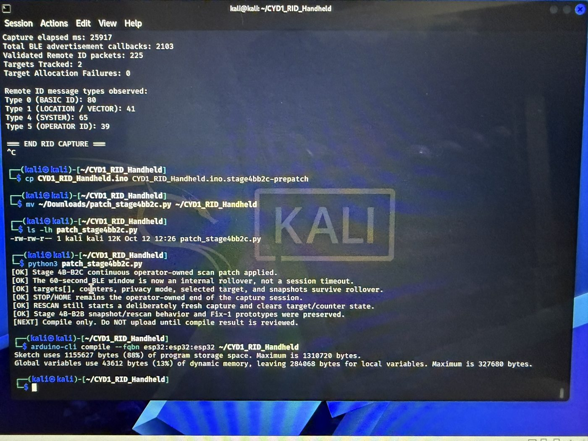

# CYD1 reference firmware — functional acceptance (October 12, 2026)

> Historical engineering report and operator-provided original Kali serial captures, reconstructed and cross-checked on November 4, 2026. **These statistics belong to the CYD1 board, not the later Waveshare firmware.** "Validated RID packets" means messages accepted by this firmware's parser; it does **not** prove zero over-the-air packet loss or regulatory compliance.

## Hardware and test sources

Receiver: ESP32-2432S028R (classic CYD1), ESP32 Arduino core 3.3.11, ~60-second asynchronous BLE scan windows. Live source: **one Ruko R111S**. Controlled bench sources: **three synthetic, low-power, SYSTEM-only ESP32 Remote ID beacons**. The synthetic units are not real aircraft, and their test payloads are not represented as legitimate aircraft identities.

## Acceptance matrix

| Test | Duration / windows | BLE advertisement callbacks | Validated RID packets | Allocations | Result / evidence |
| --- | --- | --- | --- | --- | --- |
| Two-target mixed real/synthetic endurance | 729,126 ms; 13 windows | 71,427 | **9,438** | 2; failures 0 | **PASS**; recovered original serial log `Pasted text(20261012-172720).txt` matches historical report |
| Cold power-cycle and clean restart | approximately 10-second disconnect; subsequent 17,063-ms scan | 1,406 after reboot | 220 after reboot | 2; failures 0 | **PASS per historical report**; underlying standalone log not in this curated import |
| No-target ambient BLE rejection | 307,433 ms; 6 windows | 25,904 | **0** | 0; failures 0 | **PASS per historical report**; underlying standalone log not in this curated import |
| Four-target capacity / per-target snapshots | 78,563 ms; 2 windows | 7,119 | **1,289** | 4; failures 0 | **PASS per historical report**; full standalone log not in this curated import |
| Independent full-table STALE/LOST/reacquisition | 124,920 ms; 3 windows | 11,540 | **1,986** | 4; failures 0 | **PASS**; recovered original serial log `Pasted text(20261012-185828).txt` matches historical report |

### Packet-accounting reconciliation

Two-target run: Type 0 BASIC=2,186; Type 1 LOCATION=1,094; Type 4 SYSTEM=5,083; Type 5 OPERATOR ID=1,075; **sum 9,438**.

Full-table lifecycle run: Type 0=302; Type 1=176; Type 4=1,355; Type 5=153; **sum 1,986**. Per-target totals `631 + 419 + 436 + 500 = 1,986`.

## Evidence of independent target lifecycle

The recovered four-target serial log shows T03 at packet count **96** while ACTIVE, then STALE, then LOST as the synthetic beacon was powered off. With its BLE advertiser identity unchanged, T03 returned ACTIVE in the **same slot** at 100+ packets, without RESCAN. The test repeated independent power interruptions on other beacons while unrelated targets remained ACTIVE. The two-target log also shows continuous rollover with both targets retained.

The following historical photograph shows a **redacted** single-target capture, rather than the final four-target acceptance tally:

A separate October 12 photo documents the patch/compile stage for operator-owned continuous scanning:

## Limitations / audit boundary

- Acceptance is functional, not an RF certification, full ODID conformance suite, physical flight test, or proof of detecting all drones.
- The controller was USB-powered during CYD1 tests; battery, GNSS receiver reference, and coordinate-derived RADAR belong to later Waveshare development.
- The full historical report is a reconstruction of operator-run tests. The two uploaded raw acceptance logs cross-check the strongest numerical claims; other tests are marked **report-only** until corresponding original logs are recovered.
- No raw unredacted telemetry, BLE addresses, aircraft serials, registration information, or exact geographic positions are placed in this repository. Original evidence remains with the project owner.
- Historical source was archived and SHA-256 checked; the portfolio import did not rerun the October 12 hardware acceptance or rebuild firmware. See [firmware notes](../../firmware/cyd1/README.md).
