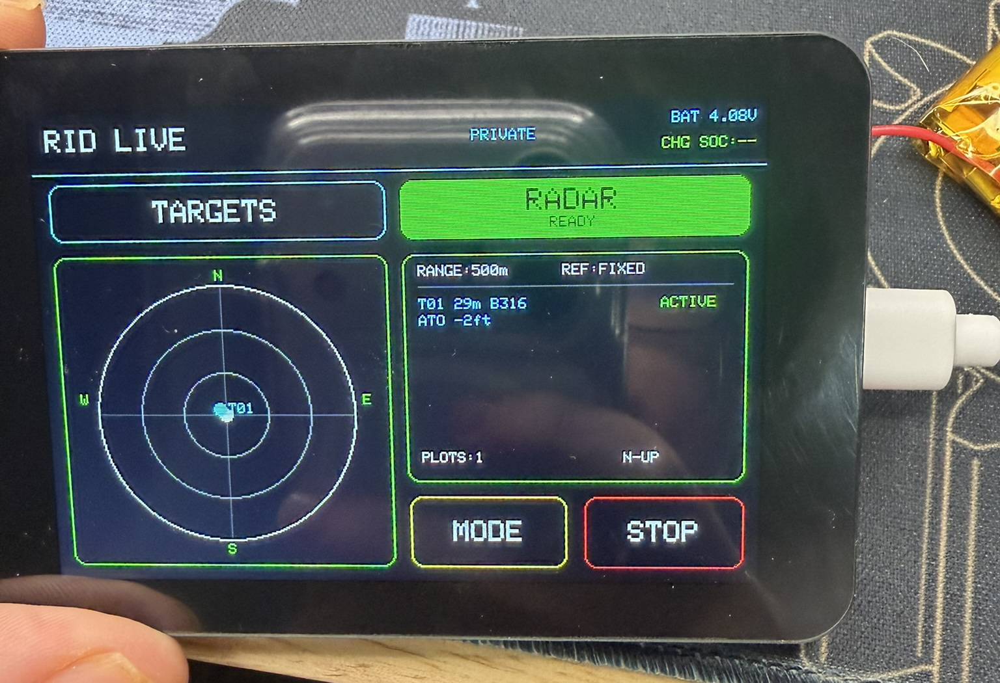
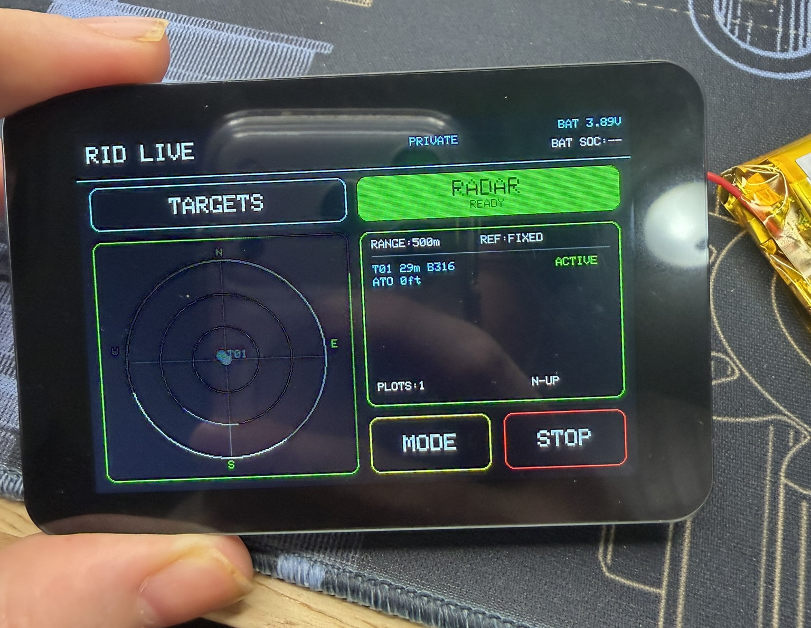
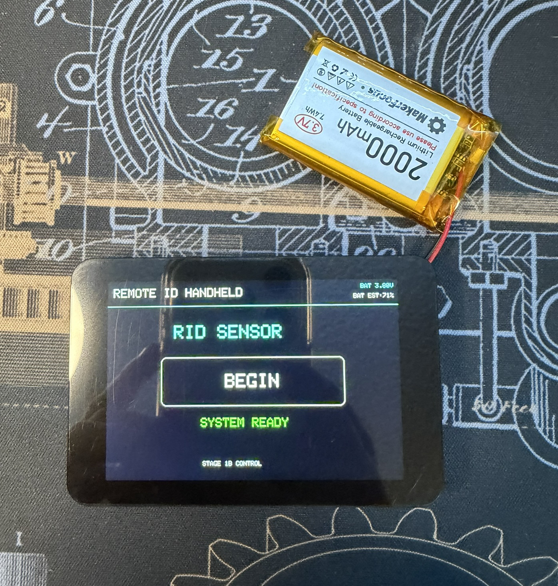
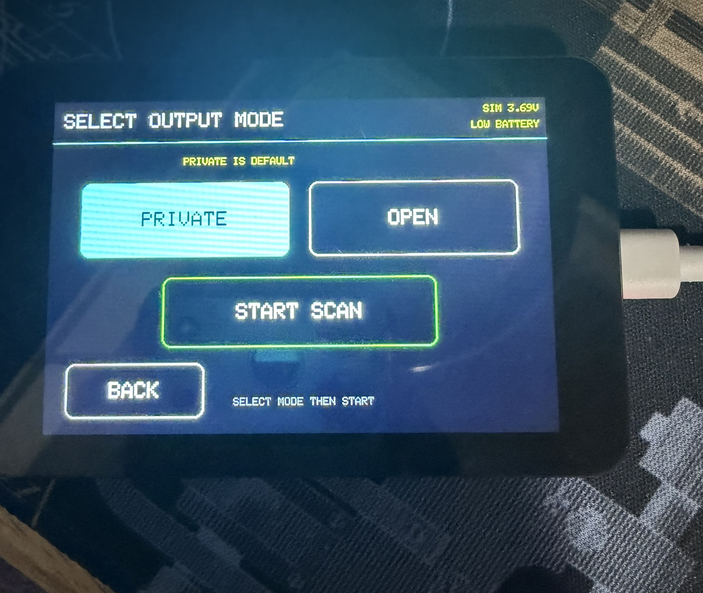

# Battery integration and provisional operator warning

The current source reads the AXP2101 at I2C address `0x34`, reports battery/USB presence, voltage, charge phase and gauge percentage, and does not add PMIC configuration writes. The register-address write used for a subsequent I2C read is not a charger-setting write.

## UI progression

BAT-D4B introduced the power header; BAT-D4C added the cell-temperature/charging notice; BAT-D4D-R2 displayed provisional `EST:%` on HOME, SELECT OUTPUT MODE, TARGETS and RADAR. NOTICE/ACK and SNAPSHOT exclude the header. The estimate remains a gauge reading, not calibrated capacity.

The earlier SOC:-- photos are historical, not the latest estimated-percentage UI. A cable absent from a still is not independent proof of a seamless power transition; that claim requires the operator test account.

## Warning implementation: BAT-D4E-3B

SHA-256 `2704617b96b24bc394ce4a9b1b7dbfa8b367c0e31776923e0ffd1ef026528670`. Eligibility requires valid PMIC status, battery present, USB absent and valid voltage. The warning activates after qualifying sampled voltage is at or below 3700 mV for at least 15 seconds from the first qualifying sample. Recovery requires at least 3800 mV for 30 seconds. USB presence, missing battery or invalid telemetry resets the warning state without waiting for the recovery timer. EST percentage is not an input. No automatic shutdown is added by this logic.

[Silent SIM LOW BATTERY clip](../../assets/waveshare/IMG_4224-SIM-low-battery-silent.mp4). These images and this clip show a display-only simulation. They are not a depleted-cell safety test or automatic-shutdown test.

## Qualifications retained

The reported 45-minute mixed-use R2 run ended at about 3.80 V / EST64% after starting at about 3.88 V / EST82%; it was an operational run, not a capacity test. The later 15-minute 3B run remained above its warning threshold. The earlier large startup/USB SOC jump remains unresolved; no reconstructed explanation is called a proven cause. Absence of smell, smoke, swelling or noticeable warmth in supervised tests is an observation, not certification.

Direct cell-temperature monitoring is absent. Full charge termination, physical low-voltage threshold, calibrated battery capacity and future GNSS/Wi-Fi loaded endurance remain open. Preserve the operator notice and supervision requirements.
