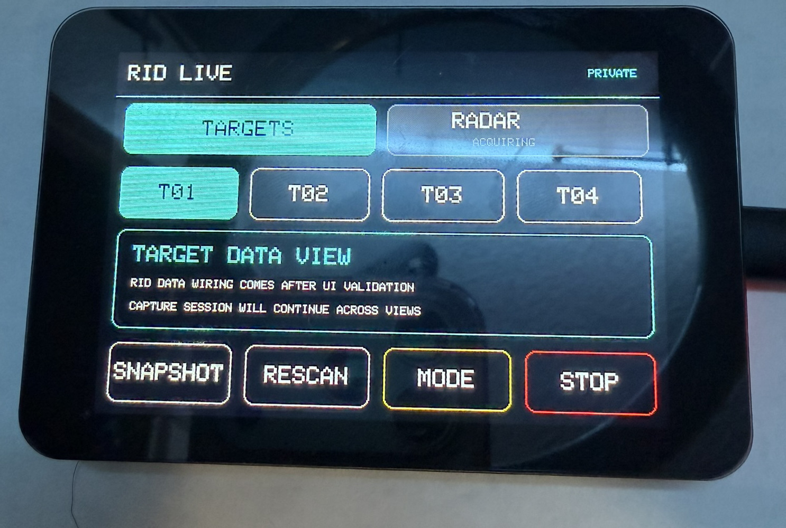
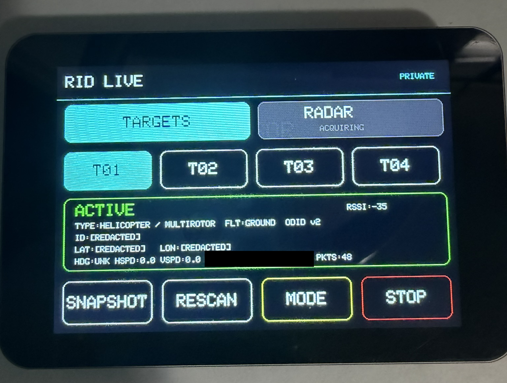

# CYD1-to-Waveshare migration and evolution

This is a retrospective narrative prepared November 6, 2026 from recovered source, local acceptance records, engineering handoffs, actual photographs and operator reports. Historical dates are not backdated Git commits.

## Preserve the receiver; replace board-specific layers

The October 12 CYD1 source was copied into the migration baseline byte-for-byte. The project first established the replacement board's memory/display/touch behavior, then restored receiver parity and operator controls. This isolated screen/coordinate problems from decoding and target-state problems.

The recorded move was from a 320 × 240 resistive CYD1 UI to a 480 × 320 landscape Waveshare Rev2.0 capacitive UI. Its retained mapping is `screenX = rawY; screenY = 319 - rawX`, clamped to the display. The report's measured corner taps are observations, not a calibrated touchscreen accuracy specification.

## Milestones

| Historical period | Work and boundary |
|---|---|
| Oct 17–18 | Vendor bring-up; graphics compatibility copy; transport/serial hardening; landscape and touch validation |
| Oct 18 | Navigation shell deliberately precedes live receiver integration |
| Oct 19 | Explicit idle startup, session control, RESCAN, frozen snapshot engine, HWCDC responsiveness, live target panel |
| Oct 20 | Geographic calculation/reference/readiness; synthetic four-position display; production fixture removal |
| Oct 21 | Manual FIXED serial reference; never-allocated row suppression; LOST-state row removal |
| Oct 23 | D4F colored lifecycle labels; D4G failed-STOP handling |
| Oct 29–30 | Acknowledgment; later physical RESET correction; battery telemetry/header and safety notice |
| Oct 31 | BAT-D4D-R2 EST percentage and coverage on all intended screens |
| Nov 3–4 | R2 45-minute battery run; read-only PMIC audit; provisional warning and regression work |
| Nov 6 | Current four-source/one-plot bench photographs; historical recovery/staging |

The early screen itself states that RID data wiring follows UI validation. It must not be captioned as proven live reception.

The later PRIVATE live panel is real-device photographic evidence. Sharing copies additionally mask selected altitude telemetry; original images remain private.

## Compatibility work

The archived Arduino_GFX 1.5.5 compatibility copy differs from the selected vendor originals in two SPI source files. `Arduino_ESP32SPI.cpp` changes two divider calls behind a core-version guard. `Arduino_ESP32SPIDMA.cpp` excludes the old divider initialization on newer cores; it is not simply a third identical argument substitution. Exact diffs are retained under `firmware/waveshare/patches`.

## Known historical gaps

The package includes D2C.1 synthetic/production sources but no standalone D2B/D2C snapshots. Early images still show evolution, but exact image-to-flashed-source attribution remains limited. Nonblocking USB output can leave incomplete serial diagnostics; broken counters are not promoted into verified statistics. No missing record is reconstructed as a successful test by inference.

[Source manifest](../../firmware/waveshare/SOURCE_MANIFEST.json) · [all 33 canonical working-area checkpoint records](../../firmware/waveshare/HISTORICAL_CHECKPOINTS.json) · [RADAR case study](RADAR.md)
