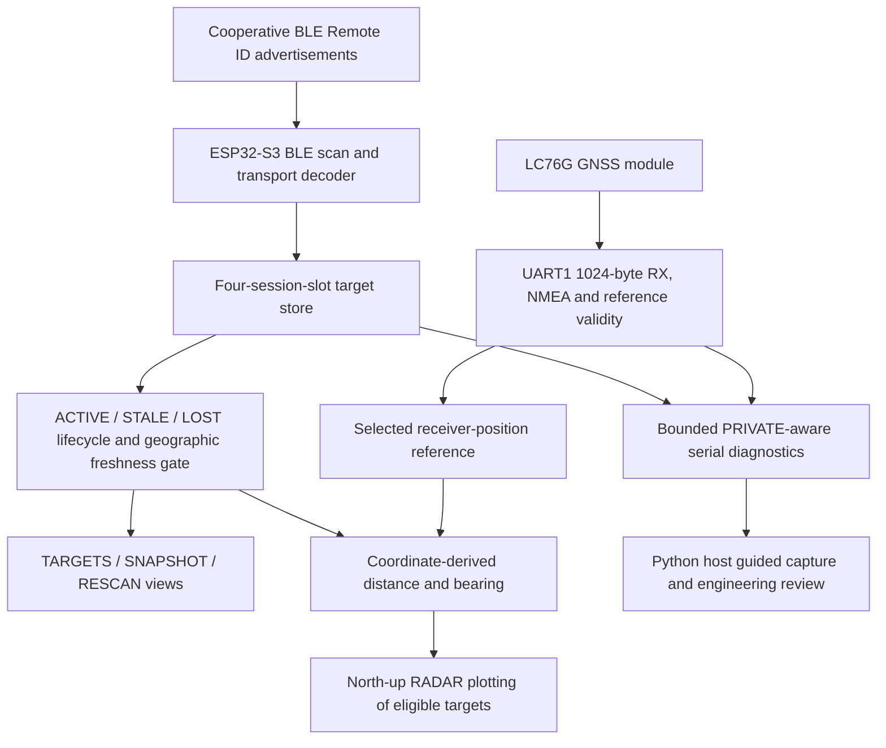

# R7 system architecture and technical boundaries

## Physical components

- **MCU/display:** Waveshare ESP32-S3-Touch-LCD-3.5 Rev2.0, landscape touchscreen.
- **Radio:** built-in ESP32-S3 BLE hardware receives cooperative Bluetooth Remote ID advertisements. No Wi-Fi Remote ID reception was implemented on this platform.
- **Position reference:** external LC76G GNSS module via UART; receive data processed as checksum-validated NMEA GGA/RMC messages.
- **Power:** USB-C during diagnostic testing; bounded standalone LiPo-only test performed. Fuel-gauge accuracy and full charging/thermal safety were not qualified.
- **Test sources:** two commercial R111S Remote ID transmitters plus two controlled ESP32 SYSTEM beacons. T01–T04 are session slots, not fixed aircraft identities.

## Data flow

## Definitions that must remain distinct

| Term | Meaning | Does not guarantee |
|---|---|---|
| Received target | An eligible BLE broadcast was decoded and attributed to a target slot | Trustworthy identity or position, 100% receipt rate |
| ACTIVE | Target state based on recent recorded activity | Fresh location/vector data or geographic plot |
| GNSS FRESH | Receiver GNSS reports current fix | Geographic accuracy independent of multipath/error |
| RADAR READY | Receiver/reference prerequisites satisfy current UI rules | All four slots have fresh, plottable geography |
| PLOTS:2 | Two target slots have usable geography for display | Two independent RF-radar tracks, precise validated distance/bearing |
| RANGE:500m | RADAR graphical plotting-scale selection | 500 m received RF range |

R7's colored callouts identify **session slots** (T01 cyan, T02 blue, T03 violet, T04 near-white), with leader lines to the computed geographic dots. The geographically eligible slots vary by received data. A RESCAN can change which real transmitter occupies a slot.

## Relevant implementation choices

- A **1,024-byte GNSS UART RX buffer**, up from the earlier 256-byte experiment, was evaluated separately to reduce observed GNSS receive-integrity errors under scanning.
- Touchscreen/GNSS servicing and targeted rendering changes helped keep the UI responsive during mixed receiver workloads.
- Snapshots freeze the display copy for the selected target; the live receiver continues processing, and returning to LIVE resumes the displayed progression.
- PRIVATE is the default output/privacy policy; OPEN is an intentional operator state. Logs must still be sanitized before public release.
- Four tracked targets are a deliberate software budget for this prototype; it does not imply support for four simultaneously plottable commercial aircraft under arbitrary conditions.

## Excluded or unvalidated

- Wi-Fi Beacon/NaN RID, microSD logging, independent network connectivity/weather updates, proposed additional RADAR UI mode, outdoor RF-range qualification, calibrated GNSS geometric accuracy, temperature-monitored battery system, production enclosure, compliance certification, and validated aircraft-avoidance functions.
