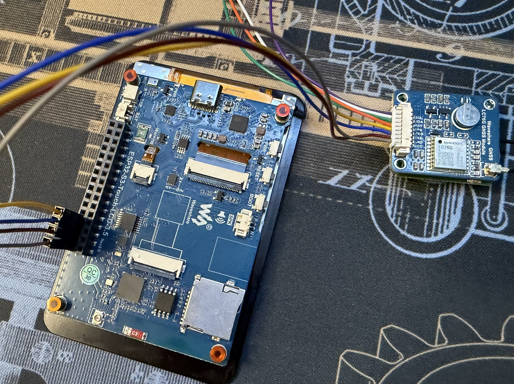
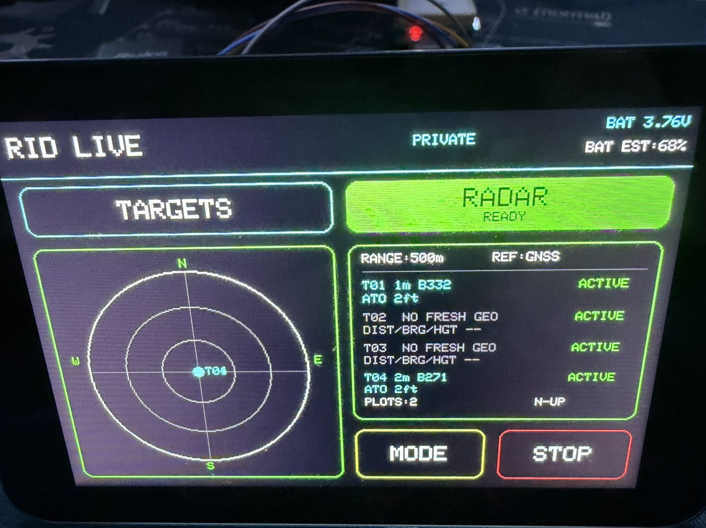
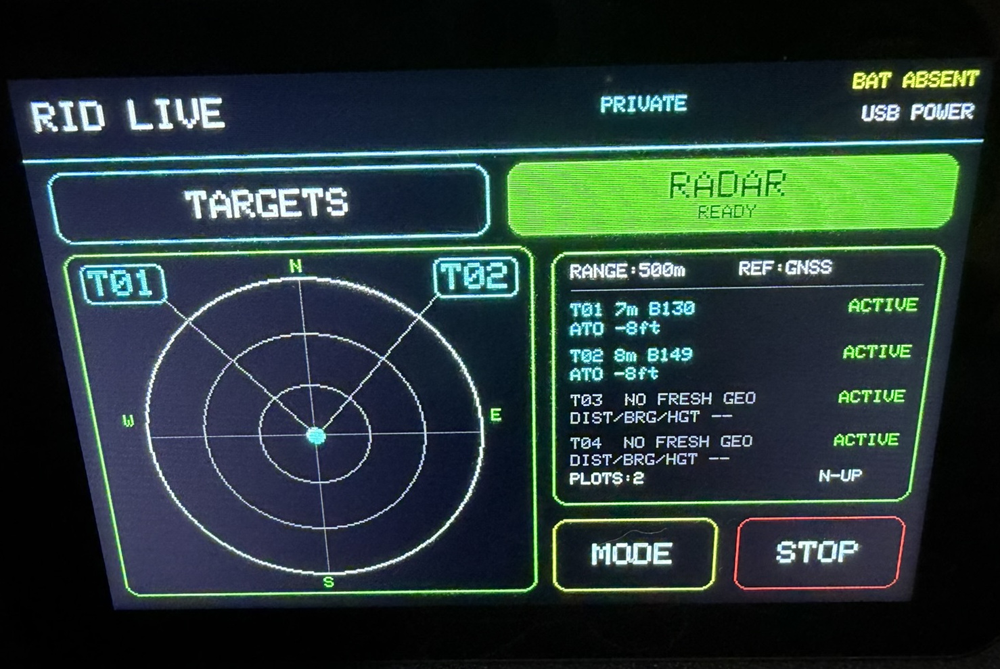
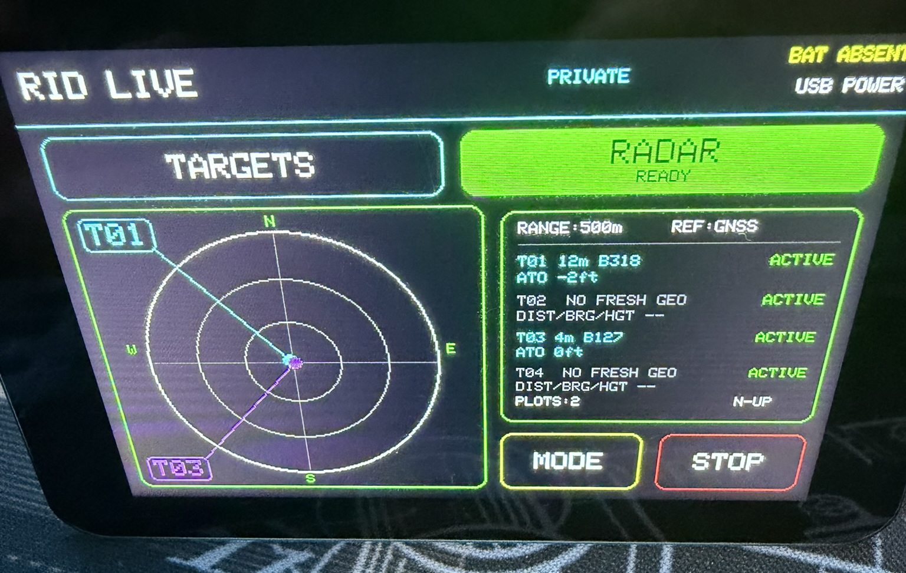
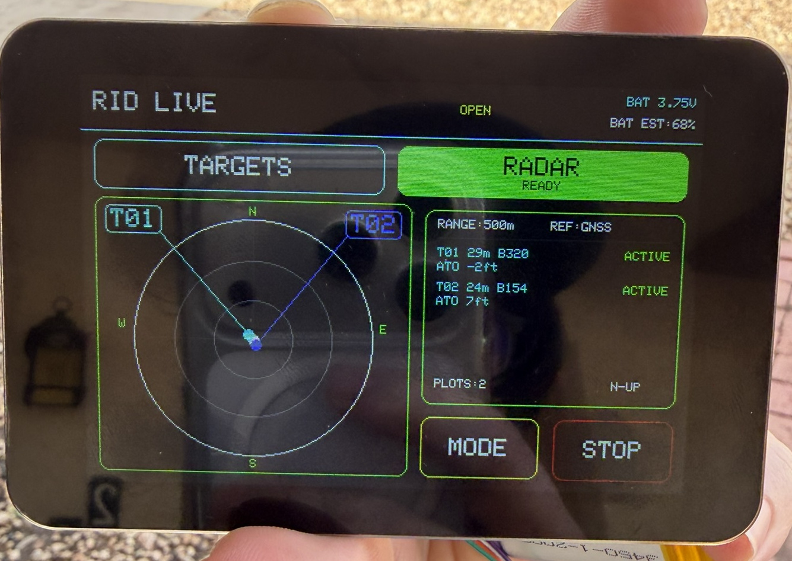

# Curated project photographs — November 2026

These ten JPEGs are **selected metadata-stripped derivatives**, not raw iCloud files. The original source photographs had GPS metadata and remain private. Images are cropped/re-encoded without changing the displayed target telemetry. Publication remains subject to the operator's final pixel-level review.

| File | Evidence value | Interpretation limit |
|---|---|---|
| [01 — Bench wiring](../../assets/waveshare/portfolio/01-waveshare-lc76g-bench-wiring.jpg) | ESP32-S3, LC76G and physical bench interconnect | Not enclosure-qualified |
| [02 — GNSS detail](../../assets/waveshare/portfolio/02-lc76g-gnss-module-detail.jpg) | GNSS receiver and harness | External module, not onboard GNSS |
| [03 — LiPo mode](../../assets/waveshare/portfolio/03-lipo-private-mode-test.jpg) | Battery-powered functional UI | Not calibrated fuel gauge/safety test |
| [04 — GNSS selection](../../assets/waveshare/portfolio/04-gnss-reference-selection.jpg) | User-selected valid receiver reference | Does not establish location accuracy |
| [05 — Early RADAR](../../assets/waveshare/portfolio/05-radar-before-callout-redesign.jpg) | Early crowded plot annotations | Historical R5/R6 design stage |
| [06 — R6 corner labels](../../assets/waveshare/portfolio/06-r6-corner-callout-layout.jpg) | Improved annotation separation | True geographic dots not moved |
| [07 — R7 final](../../assets/waveshare/portfolio/07-r7-color-radar.jpg) | Actual final colored corner label/dot/leader scheme | Two real eligible plots, not four real aircraft |
| [08 — TARGETS](../../assets/waveshare/portfolio/08-r7-target-details.jpg) | Current target details and state | Slot labels are session-specific |
| [09 — SNAPSHOT](../../assets/waveshare/portfolio/09-r7-frozen-snapshot.jpg) | Frozen snapshot of real R111S target | Not continuous recording of every frame |
| [10 — Outdoor trial](../../assets/waveshare/portfolio/10-outdoor-portable-radar.jpg) | Battery-powered property-range evaluation | Does not prove a calibrated RF cutoff |

### Suggested visual sequence

**Privacy boundary:** Do not add raw photos, iCloud ZIPs, original EXIF data, personal addresses, actual transmitter identifiers or unsanitized packet captures to public GitHub. The **pre-existing** 25 JPEGs and three silent MP4s received a separate November 18 metadata, media-integrity, sample-frame, and Git-history review, with conditional publication clearance; final owner visual review and privacy approval remain required.
