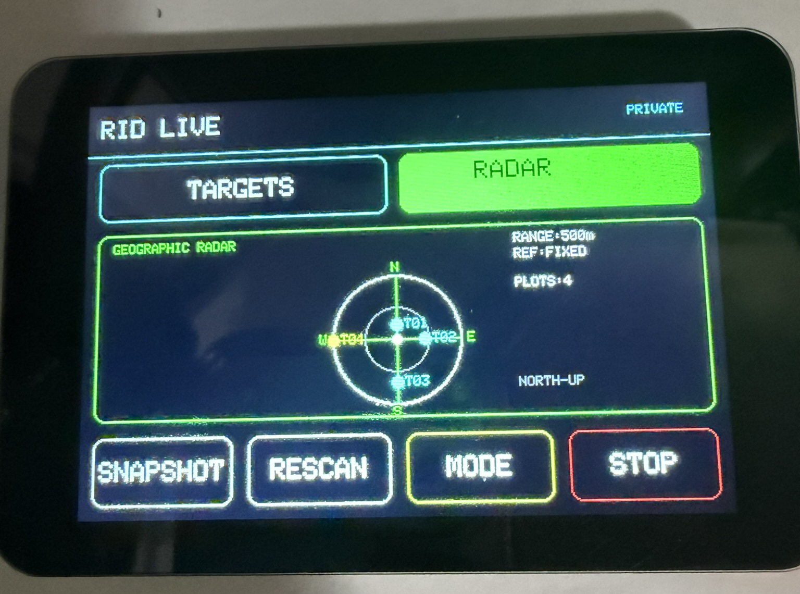
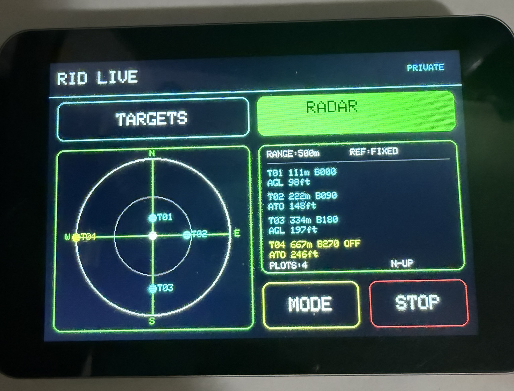
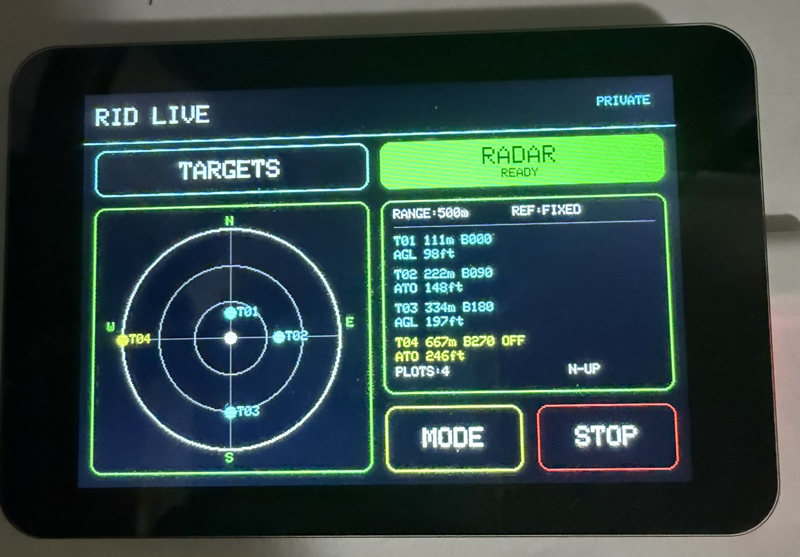
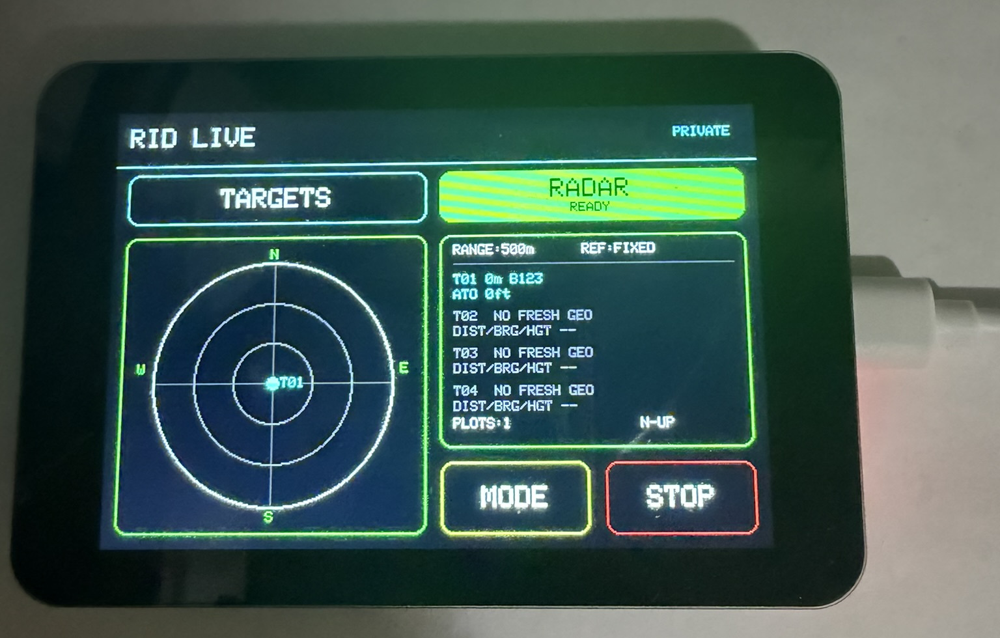
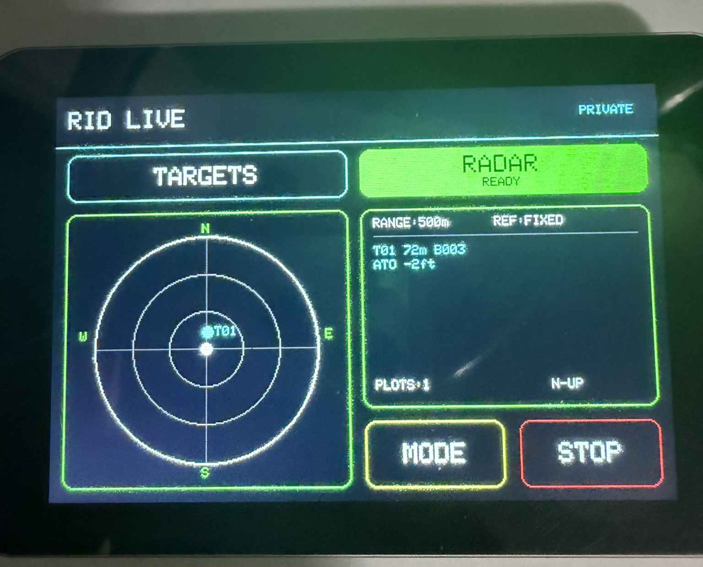
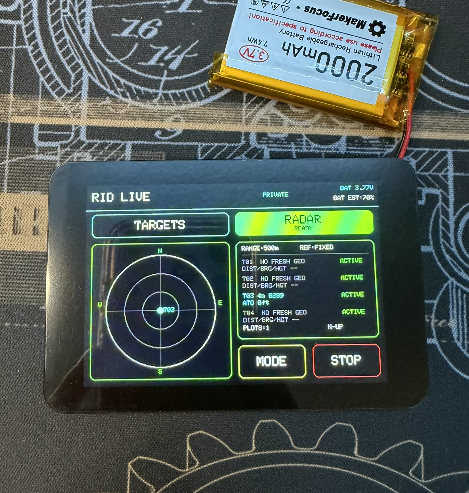

# Geographic RADAR: design, evolution and evidence

## Three different questions

1. Is a source being received and allocated a target slot?
2. Does that source have a fresh, usable **aircraft** position?
3. Does the receiver have an explicitly valid position reference?

Reception alone does not answer the other two. The north-up scope solves horizontal distance and true bearing from coordinate pairs; RSSI is separate telemetry. A SYSTEM message is not substituted for missing aircraft Location/Vector data. Adding receiver GNSS will not create positions for SYSTEM-only beacons.

The implementation separates mutex-protected target snapshots, receiver-reference provider, geographic solver, projection and renderer. Its source preserves `WS_REF_GNSS` as a future provider label; an enum does not constitute an integrated module. The current live demonstrations use FIXED coordinates entered locally and held in RAM.

## Repeatable layout testing was explicitly synthetic

The four cardinal targets in this series were injected by firmware. The 111/222/334/667 m pattern and off-scale marker support repeatable geometry/UI checks, not a four-drone reception or 667 m radio-range result. The archive retains a separately labeled synthetic fixture and a production version with the fixture code removed. The earliest image's exact binary/source identity is not established solely by appearance.

The selected geographic scale is 500 m, not a claim of measured coverage. Three rings represent one third, two thirds and full scale; yellow at the rim means off-scale, not STALE.

## Never-allocated and LOST rows

The first correction skipped invalid/unallocated snapshots. A later guard skipped `snapshot.stateCode == 3` (LOST). Neither renderer guard deallocates a backend record or replaces the lifecycle timer. The photos document appearance; source/history supplies allocation-state interpretation.

A suspected readiness-gated refresh defect was rejected after inspecting `serviceWaveshareRadarRefresh()`. The actual D4E visibility change did not alter that service. An initial observation ended at a reported 9.316 s since reception, below the approximately 10 s LOST boundary. The longer observation was required; code was not changed merely to fit the short clip.

[Historical independent-source disappearance clip](../../assets/waveshare/IMG_3969-lifecycle-silent.mp4) · [Later ACTIVE/STALE/hidden clip](../../assets/waveshare/IMG_3986-active-stale-hidden-silent.mp4).

Clip time is not synchronized packet age. The later video visibly shows green ACTIVE, yellow STALE, then an absent row—not a printed LOST label.

## Four sources, only one geographic plot

In the operator-described November 6 setup, the R111S plus three currently SYSTEM-only ESP32 beacons produce four ACTIVE rows. Only the R111S supplies aircraft coordinates for a plot. `PLOTS:1` and `NO FRESH GEO` preserve that distinction. Slots depend on reception order; T03 is not a permanent R111S identity.

## Remaining geographic limits

Indoor movement observations do not establish outdoor location accuracy or range. GNSS/reference aging, legitimate zero-coordinate edge handling, measured separation and current-build forced-off lifecycle regression remain separately tracked. Receiver movement with an unchanged FIXED origin is not live receiver tracking.
